# Pacific Rim — Última Linha de Defesa

Jogo de estratégia em Python inspirado em *Pacific Rim*. Você comanda o Shatterdome:
treina pilotos, constrói Jaegers, administra os créditos e defende a costa dos ataques
dos Kaijus até o relógio do fim do mundo zerar e chegar a hora da **Operação Pitfall**.
A campanha é salva automaticamente e pode ser continuada depois.

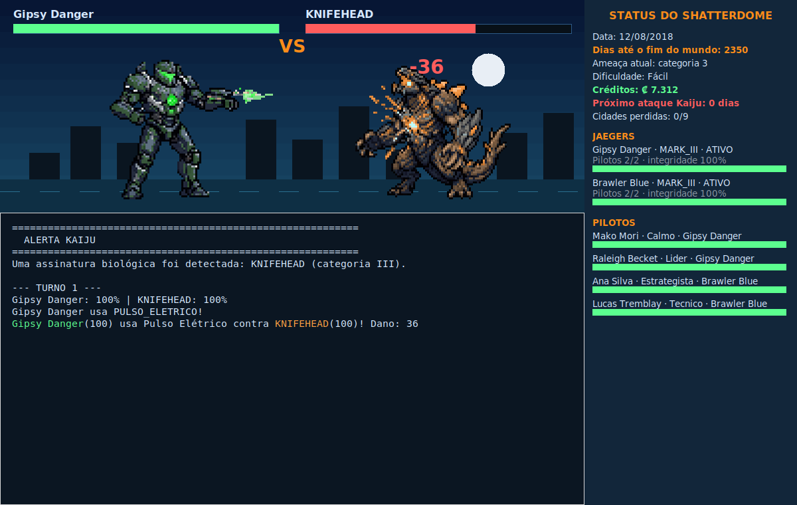

O jogo roda de dois jeitos, com a mesma campanha:

- **Interface gráfica** (`gui.py`): janela com botões, painel de status ao vivo e batalhas animadas com sprites.
- **Terminal** (`main.py`): menus navegáveis com as setas do teclado.

---

## Como rodar

Requisitos: Python 3.10+ e, para a interface gráfica, o tkinter.

```bash
# tkinter (Ubuntu/WSL; no Windows e no macOS ele já vem com o Python)
sudo apt install -y python3-tk

# ambiente virtual e dependências
python3 -m venv venv
source venv/bin/activate
pip install -r requirements.txt

# interface gráfica
python gui.py

# ou no terminal
python main.py
```

No terminal, use **↑/↓** e **Enter** nos menus e **Espaço** para marcar pilotos.
Sem o InquirerPy instalado, o jogo continua funcionando, mas com escolhas por número.

**Save:** a campanha é gravada em `campanha.sav` sempre que você volta à central, a
cada ataque e ao escolher "Salvar e sair". Ao abrir o jogo de novo, aparece a opção
**Continuar campanha**. O save é apagado quando a campanha termina, com vitória ou derrota.

---

## Como funciona

### A campanha

A guerra vai de **10/08/2013** a **17/01/2025** e é dividida em cinco fases de 20% do
tempo cada. Em cada fase os Kaijus ficam mais fortes (categorias I a V) e uma nova
geração de Jaeger é liberada.

O tempo é o recurso principal. Cada ação gasta dias, e **os Kaijus atacam sozinhos**
na data prevista, em intervalos que encurtam a cada fase: 200, 160, 130, 100 e 80 dias,
ajustados pela dificuldade. A central mostra quantos dias faltam para o próximo ataque.

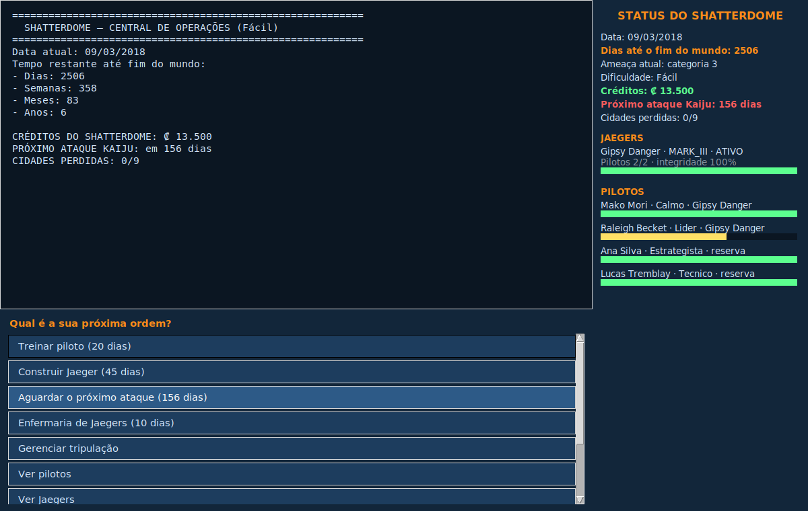

| Ordem | Tempo | O que faz |
|---|---|---|
| Treinar piloto | 20 dias | Escolhe 1 entre 3 candidatos sorteados. O treinamento pode reprovar o candidato. |
| Construir Jaeger | 45 dias | Escolhe dois pilotos, o nome, a geração e a arma assinatura. |
| Aguardar o próximo ataque | até o ataque | Avança o relógio direto para o alerta; os pilotos se recuperam nesse tempo. |
| Enfermaria de Jaegers | 10 dias | Repara integridade em pacotes (+10%, +25%, +50% ou completo). |
| Gerenciar tripulação | — | Aloca ou desaloca pilotos de um Jaeger. |
| Ver pilotos / Ver Jaegers | — | Mostra fichas, nível, vínculos, saúde e alocação. |
| Estatísticas e histórico | — | Placar da campanha, Kaijus derrotados e as últimas batalhas. |
| Memorial dos pilotos | — | Homenagem aos pilotos mortos em combate. |
| Salvar e sair | — | Grava a campanha para continuar depois. |

Quando chega a data, soa o **alerta Kaiju**. Você escolhe um Jaeger para defender a
cidade ou não envia nenhum. Se a cidade ficar desprotegida, ou se o Jaeger perder, ela
é devastada: custa créditos de reconstrução e conta para o limite de cidades perdidas.

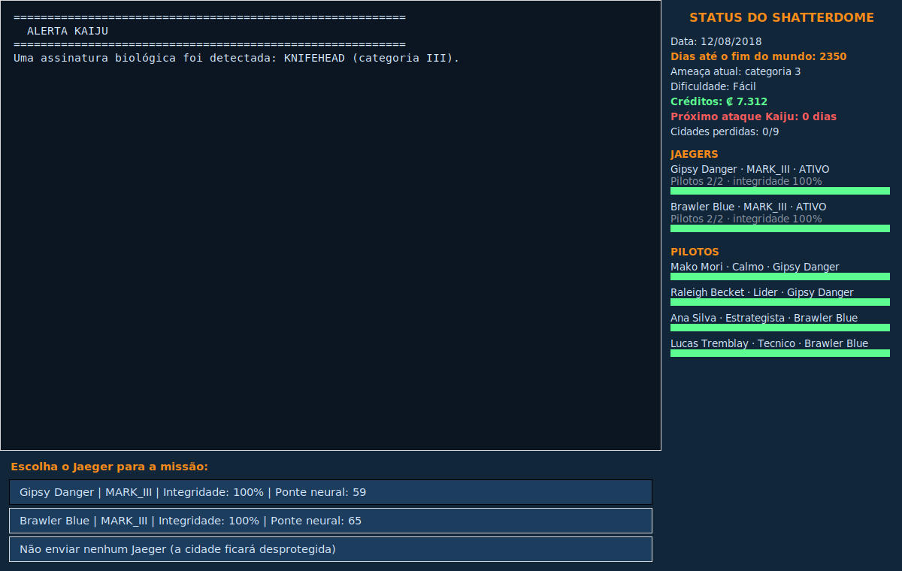

A tela **Estatísticas e histórico** mostra:
- ataques enfrentados, vitórias, derrotas e cidades deixadas sem defesa, com a taxa de vitória em combate;
- os Kaijus derrotados por categoria, os Jaegers mais vitoriosos e os pilotos mais experientes;
- as últimas 10 batalhas, com data, resultado, Kaiju e Jaeger.

O histórico faz parte do save.

**Eventos entre ataques:** depois de cada ataque, há 50% de chance de algo acontecer no
Shatterdome. Cada evento só é sorteado quando faz sentido; por exemplo, não há pane no
hangar sem Jaegers.

| Evento | Efeito |
|---|---|
| Verba extra | +₡ 1.000 por fase da guerra |
| Corte de orçamento | -₡ 800 por fase, sem deixar o saldo negativo |
| Veterano voluntário | Um piloto de nível 2 entra na reserva, de graça |
| Atividade na Fenda | O próximo ataque chega 20 dias antes |
| Descoberta científica | O próximo ataque é adiado em 30 dias |
| Pane no hangar | Um Jaeger perde 15% de integridade |
| Moral elevada | Pilotos feridos recuperam 20% de saúde |

Os valores ficam em `precos.json`, na seção `eventos`.

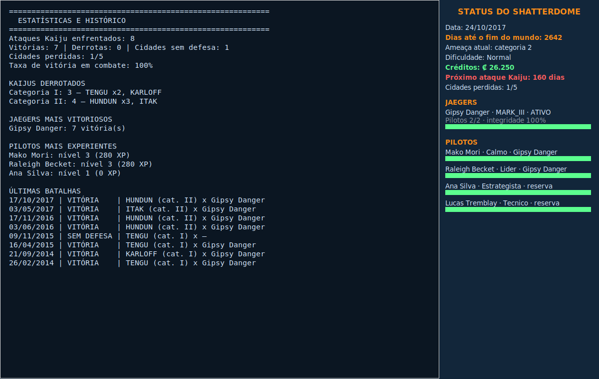

**Narração:** os momentos de história são contados por um piloto veterano, em primeira
pessoa, como na abertura do filme. São eles: o prólogo do K-Day, o encerramento e a volta
do Programa Jaeger, a descida para a Operação Pitfall e os dois finais. Cada trecho tem voz
gravada, e o texto aparece no ritmo da fala. É preciso um player de linha de comando
(`ffplay`, `afplay` ou `mpg123`); sem ele, a narração aparece só em texto e o jogo fica sem efeitos sonoros.

**Finais:**
- **Vitória:** chegar ao fim do relógio e vencer a Operação Pitfall contra um Kaiju categoria V.
- **Derrota:**
  - perder a Pitfall;
  - perder cidades demais;
  - ficar sem créditos e sem Jaegers operacionais.
- **No meio do caminho:** ao entrar na última fase, o Programa Jaeger é encerrado e depois reativado, numa sequência narrada.

### Dificuldade

Escolhida no início de cada campanha. Os valores ficam em `precos.json`.

| | Fácil | Normal | Difícil |
|---|---|---|---|
| Créditos iniciais | ₡ 13.500 | ₡ 9.000 | ₡ 9.000 |
| Preços | x0,75 | x1 | x1 |
| Recompensa por vitória | x1,5 | x1 | x1 |
| Dano recebido pelo Jaeger | x0,85 | x1 | x1,05 |
| Dano recebido pelo Kaiju | x1,15 | x1 | x1 |
| Aprovação no treinamento | 95% | 80% | 70% |
| Inteligência dos candidatos | 70–100 | 60–100 | 50–90 |
| Intervalo entre ataques | x1,2 | x1 | x0,8 |
| Cidades perdidas até a derrota | 9 | 8 | 6 |
| **Taxa de Vitórias** | **92%** | **42%** | **25%** |

### Pilotos e ponte neural

Cada piloto tem nacionalidade, personalidade, inteligência e saúde. A força da dupla
num Jaeger vem da **ponte neural** (`pilotos/conexaoPilotos.py`), calculada a partir de:

- **personalidades compatíveis:** Líder + Estrategista é o melhor par; quem tem um Rebelde na dupla sincroniza mal;
- **nacionalidades próximas;**
- **inteligência média da dupla;**
- **pilotos feridos**, que reduzem a conexão.

A ponte neural define a precisão dos ataques. As tabelas ficam em `pilotos/conexao.json`.

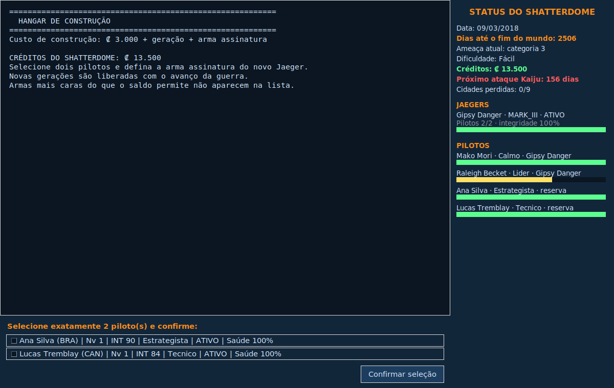

Ao formar uma dupla, seja construindo um Jaeger ou completando a tripulação, o jogo mostra
a **ponte neural prevista** antes de confirmar, com o detalhamento de cada fator.
Assim você pode testar outras combinações antes de decidir.

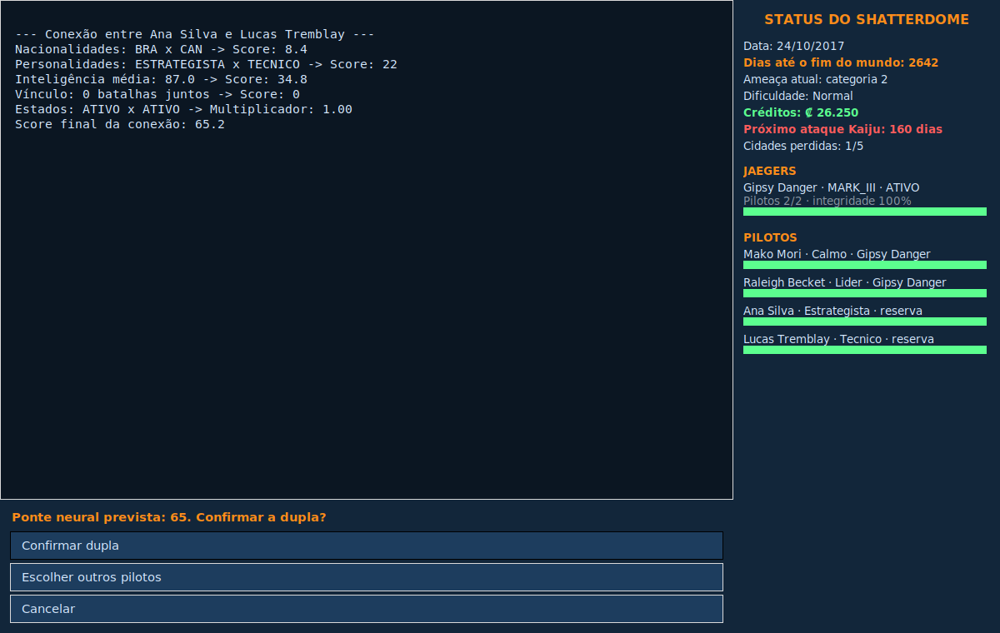

Quando um Jaeger é destruído, cada piloto tem **10% de chance de morrer**. Quem morre sai
do efetivo e vai para o **Memorial dos pilotos**, com o nível, o Jaeger e o Kaiju da última
batalha. Os outros saem gravemente feridos (-20 a -60 de saúde) e se recuperam com o passar
dos dias, num ritmo que depende do temperamento:

| Calmo | Determinado | Estrategista | Técnico | Líder | Impulsivo | Rebelde |
|---|---|---|---|---|---|---|
| x1,5 | x1,3 | x1,2 | x1,1 | x1,0 | x0,7 | x0,6 |

**Evolução:** os pilotos ganham experiência a cada batalha: 40 XP na vitória e 15 na
derrota. A cada 100 XP sobem de nível e ganham +4 de inteligência, até o máximo de 130.
Duplas que lutam juntas criam um **vínculo**: cada batalha juntas soma +2 na ponte neural,
até +20. Por isso, manter a mesma dupla no mesmo Jaeger vale a pena. A ficha do piloto
mostra o nível, o XP e os vínculos.

### Jaegers: gerações e armas

O custo de um Jaeger é a soma do custo base, da geração e da arma. As gerações são
liberadas com o avanço da guerra. As bloqueadas aparecem com a data em que serão liberadas.

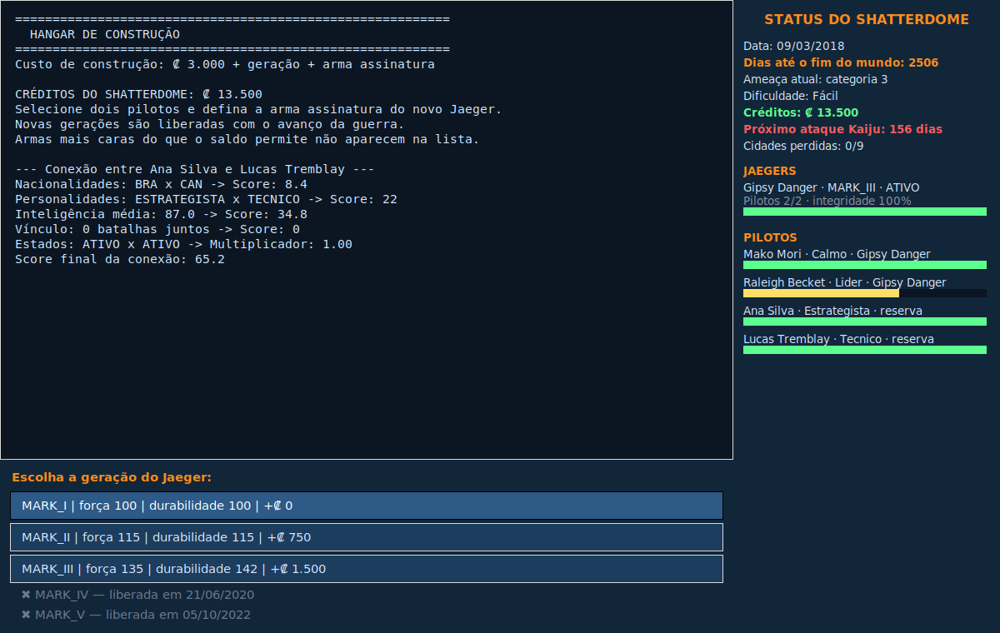

| Geração | Força / Durabilidade | Custo extra | Liberada em |
|---|---|---|---|
| MARK_I | 100 / 100 | ₡ 0 | início |
| MARK_II | 115 / 115 | ₡ 1.000 | 24/11/2015 |
| MARK_III | 135 / 142 | ₡ 2.000 | 09/03/2018 |
| MARK_IV | 168 / 188 | ₡ 3.500 | 21/06/2020 |
| MARK_V | 195 / 218 | ₡ 5.000 | 05/10/2022 |

Cada arma troca dano por precisão. Armas que o saldo não cobre não aparecem na lista.

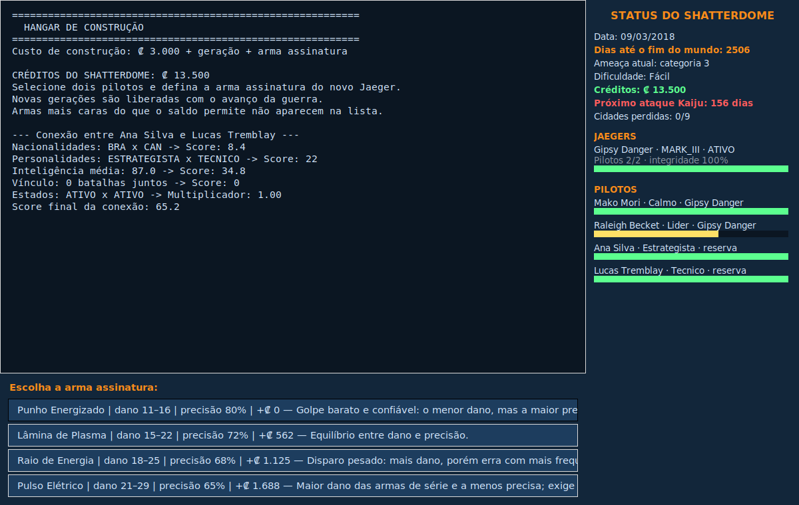

| Arma | Dano | Precisão* | Custo extra |
|---|---|---|---|
| Punho Energizado | 11–16 | 80% | ₡ 0 |
| Lâmina de Plasma | 15–22 | 72% | ₡ 750 |
| Raio de Energia | 18–25 | 68% | ₡ 1.500 |
| Pulso Elétrico | 21–29 | 65% | ₡ 2.250 |

\* Com ponte neural 70. Pilotos mais sincronizados acertam mais, e a força do Jaeger multiplica o dano.

O nome do Jaeger é sugerido combinando um nome e um sobrenome de duas listas, como
"Brawler Blue" ou "Saber Tango". Você pode aceitar a sugestão ou digitar outro nome.

### Jaegers históricos

Os Jaegers do filme podem ser construídos. Eles são mais fortes que um Jaeger comum da
mesma geração e têm arma exclusiva, mas com limitações:

- **Tripulação original:** só podem ser construídos com os pilotos do filme, vivos e livres.
- **Geração liberada:** só depois que a fase da geração deles começar.
- **Um de cada:** só um de cada em serviço por vez.
- **Lenda morta não volta:** se um piloto lendário morrer, aquele Jaeger não pode mais ser construído.

| Jaeger | Geração | Tripulação original | Arma exclusiva | Custo extra |
|---|---|---|---|---|
| Cherno Alpha | MARK_I | Aleksis e Sasha Kaidanovsky | Punho Tesla | ₡ 1.500 |
| Gipsy Danger | MARK_III | Raleigh Becket e Mako Mori | Soco Nuclear | ₡ 3.000 |
| Crimson Typhoon | MARK_IV | Cheung, Hu e Jin Wei (três pilotos) | Lâminas Giratórias | ₡ 4.000 |
| Striker Eureka | MARK_V | Herc e Chuck Hansen | Lâminas Sting | ₡ 5.000 |

**Como conseguir os pilotos lendários:**
- **Academia:** 10% de chance de a equipe aparecer como candidata (★ LENDAS).
- **Evento:** um evento raro traz a equipe como voluntária.

Em ambos os casos, a equipe chega completa e no nível 3, com a ponte neural já afinada
entre si (vínculo de 5 batalhas) e sem risco de reprovar. No hangar, os modelos bloqueados
aparecem com o motivo, por exemplo "requer Raleigh Becket e Mako Mori".

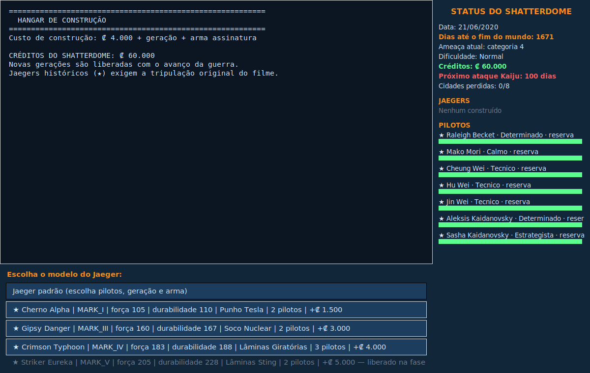

Na simulação, quando a equipe lendária está disponível, ela aparece em cerca de 60% das
campanhas (Cherno), 20% (Gipsy), 11% (Crimson) e 6% (Striker). Contra Kaijus da
categoria seguinte à sua geração, um histórico vence bem mais que um Jaeger comum.
Por exemplo, o Gipsy vence 70% contra a categoria IV, e um MARK_III comum, 43%.

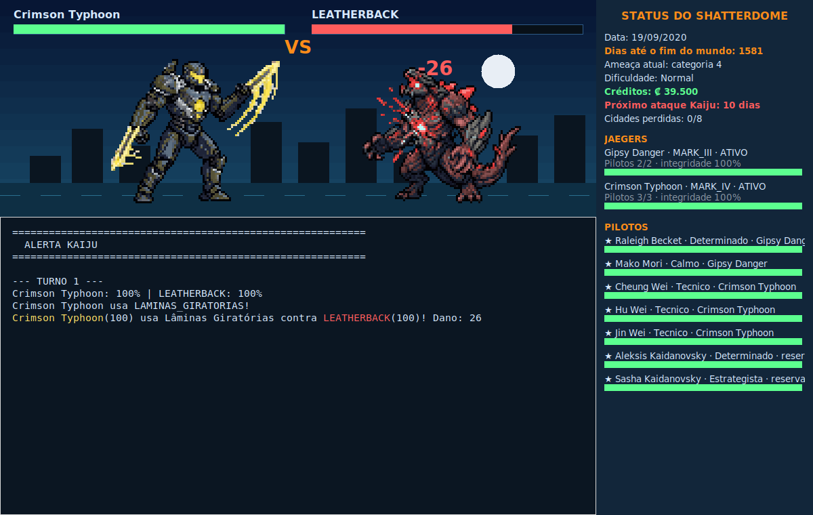

### A batalha

O combate é por turnos: o Jaeger ataca e, se o Kaiju sobreviver, o Kaiju revida.
Cada golpe pode errar, e o dano é reduzido pela durabilidade de quem apanha.
Na interface gráfica, cada golpe é animado:

- **Ataque:** o atacante avança e usa o quadro do golpe. No Jaeger, depende da arma: soco, lâmina, raio ou pulso. No Kaiju, do ataque: garras, sopro de ácido ou espinhos.
- **Impacto:** quem apanha muda para o quadro de dano, treme e mostra o dano em vermelho. Se o golpe falha, aparece "ERROU".
- **Barras de vida:** diminuem a cada golpe.

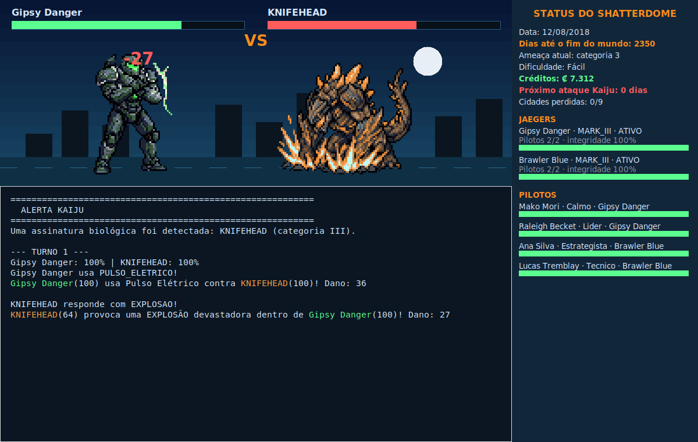

No fim, o vencedor comemora e o perdedor cai:

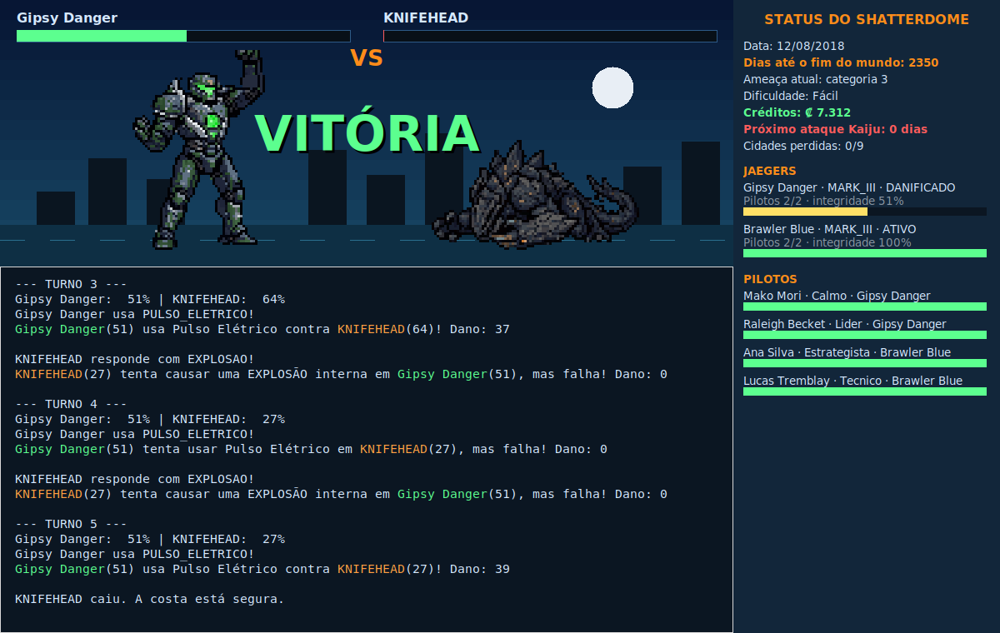

Cada geração de Jaeger e cada categoria de Kaiju tem a sua cor de brilho. Assim dá para
reconhecer a ameaça só de olhar:

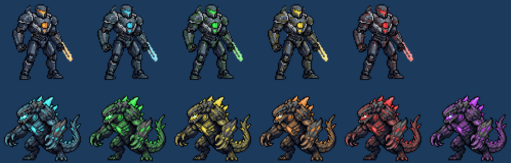

*Em cima, Jaegers MARK_I a MARK_V. Embaixo, Kaijus de categoria desconhecida e I a V.*

---

## Como foi feito

### Estrutura

```
main.py                 campanha: central, alertas, hangar, academia, enfermaria, save, finais
gui.py                  interface gráfica (tkinter) e cena de batalha animada
dificuldade.py          nível escolhido, lido por combate, academia e orçamento
util.py                 menus (InquirerPy ou modo reserva), decorators e gancho da interface
precos.json             créditos, custos, dificuldades, gerações, dias por ação, ataques e XP
campanha.sav            save da campanha (criado ao jogar; ignorado pelo git)
centroOperacoes/
  cronometro.py         relógio do fim do mundo (singleton) e fases da guerra
  historia.py           narrações: prólogo, desativação/reativação e finais
jaegers/
  jaeger.py             classe Jaeger: estado, pilotos, combate
  categorias.py         gerações MARK_I–V (strategy de atributos) e custos
  historicos.py/.json   Jaegers do filme, tripulações originais e regras de recrutamento
  ataques.py/.json      armas: dano, precisão, custo e descrição
  factoryJaeger.py      construção: pilotos, nome sugerido, geração e arma
kaijus/                 classe Kaiju, categorias, ataques e base de Kaijus
pilotos/
  piloto.py             classe Piloto: personalidades, recuperação, nível e vínculos
  conexaoPilotos.py     cálculo da ponte neural, com o bônus de vínculo (tabelas em conexao.json)
  factoryPiloto.py      geração de candidatos e treinamento
repositorios/           listas em memória de pilotos, Jaegers e Kaijus derrotados
assets/                 folhas de sprites do Jaeger e do Kaiju
assets/narracao/        voz do piloto narrador (MP3) e a duração de cada trecho
assets/efeitos/         efeitos sonoros sintetizados (WAV)
audio.py                toca a voz e os efeitos (ffplay, afplay ou mpg123)
tests/                  testes automatizados (pytest)
simular.py              simulação de campanhas para medir o equilíbrio
gerar_narracao.py       gera a voz do narrador a partir dos textos da história
gerar_efeitos.py        sintetiza os efeitos sonoros com o ffmpeg
```

### Padrões usados

- **Factory:** `FabricaJaeger`, `FabricaKaiju` e `FabricaPilotos` concentram a criação dos objetos.
- **Strategy:** cada geração de Jaeger e cada categoria de Kaiju é uma função que ajusta os atributos, escolhida por um dicionário.
- **Singleton:** o `Cronometro` é único na campanha, pelo decorator `@singleton`.
- **Repository:** `RepositorioPilotos` e `RepositorioJaegers` guardam o efetivo.
- **Decorators de registro:** `@registrar_piloto` e `@registrar_jaeger` adicionam ao repositório tudo o que as fábricas criam.
- **Configuração em JSON:** preços, dificuldades, armas, ritmo dos ataques, XP e ponte neural podem ser balanceados sem mexer no código.

### O save

`salvar_campanha` grava com `pickle` a dificuldade, a data, o estado da campanha
(créditos, cidades perdidas, próximo ataque) e os repositórios de pilotos, Jaegers e
Kaijus derrotados. O `pickle` preserva as ligações entre os objetos: o piloto continua
apontando para o seu Jaeger, e o Jaeger para os seus pilotos. Um save corrompido, ou de
uma versão antiga do jogo, é ignorado com um aviso.

### A interface gráfica

A interface gráfica não reescreve o jogo. Ela substitui o terminal, e toda a lógica
continua em `main.py`:

1. A campanha roda numa **thread** própria. A janela tkinter fica na thread principal, a única que pode desenhar.
2. `util.prompt`, `util.limpar_tela`, `print` e `input` são redirecionados para a janela quando ela está ativa (`util.usar_interface`).
3. Quando o jogo faz uma pergunta, a janela monta o controle certo:
   - menus viram botões;
   - a seleção de pilotos vira caixas de marcar;
   - o nome do Jaeger vira um campo de texto;
   - as pausas viram um botão "Continuar".

   A thread do jogo espera a resposta numa fila (`queue.Queue`).
4. A batalha avisa a janela em cada golpe (`util.evento_batalha`). No terminal, esse aviso não faz nada.
5. O painel lateral relê o estado do jogo a cada 0,5 s: data, créditos e barras de saúde.

Os sprites vêm de duas folhas de 256×256 em `assets/`. Cada quadro é recortado por
coordenadas (`SPRITES_JAEGER` e `SPRITES_KAIJU` em `gui.py`) e ampliado 3x. Os quadros
do Kaiju são espelhados para ele ficar de frente para o Jaeger.

As cores das variantes são geradas a partir da mesma folha:
- **Quais pixels mudam:** os saturados, ou seja, brilhos, visor e energia. A armadura fica como está.
- **O que muda:** só a matiz, que passa para a cor da geração ou da categoria; a luminosidade é mantida.
- **Pixels transparentes:** são descobertos lendo a folha com dois fundos diferentes e ficam intactos.
- **Desempenho:** cada variante é gerada uma vez (cerca de 0,2 s) e guardada em cache.

Tudo usa só o `tk.PhotoImage` e o `colorsys`, sem dependências extras.

### A voz do narrador

A voz é a **Antonio** (neural, pt-BR, da Microsoft), gerada com o `edge-tts`:
- **Ritmo e tom:** mais lenta e mais grave que o padrão, como um veterano cansado de guerra.
- **Filtro de cinema:** o `ffmpeg` reforça os graves, acrescenta um eco curto de cabine e corta um pouco os agudos.
- **Pronúncia:** termos como "Jaeger" e "Shatterdome" são falados como no filme.

Os textos ficam em `NARRACOES`, no `centroOperacoes/historia.py`. Depois de mudar um texto,
gere a voz de novo:

```bash
pip install -r requirements-dev.txt
python gerar_narracao.py   # precisa de internet e do ffmpeg
```

O nome de cada arquivo leva um resumo do texto. Assim, um texto alterado nunca toca o
áudio antigo, e o script só regenera o que mudou. Ele também grava a duração de cada
trecho em `duracoes.json`, que o jogo usa para sincronizar o texto com a fala.

### Efeitos sonoros

Os 23 efeitos são **sintetizados**, não gravados. Cada um é uma fórmula de onda em
`gerar_efeitos.py` (notas com harmônicos, ruído filtrado, varreduras de frequência) que o
filtro `aevalsrc` do `ffmpeg` transforma em áudio. Depois, o volume de cada um é ajustado
para soarem equilibrados entre si. Assim, não há sons de terceiros nem questões de licença.

| Momento | Som |
|---|---|
| Início da batalha | Rugido do Kaiju |
| Golpe do Jaeger | Soco (baque), lâmina (corte metálico), raio (varredura de energia) ou pulso (estalos elétricos), conforme a arma |
| Golpe do Kaiju | Garras (dois rasgos), ácido (chiado) ou explosão |
| Acerto / erro | Impacto metálico / deslocamento de ar |
| Desfecho | Fanfarra de vitória, ou explosão do Jaeger seguida de acordes de derrota |
| Alerta Kaiju | Sirene |
| Treinamento | Aprovado (dois tons subindo) ou reprovado (tons descendo) |
| Construção / reparo | Marteladas de forja / catraca e chave |
| Recompensa / nível | Moedas / arpejo subindo |
| Cidade devastada / piloto morto | Explosão com estrondo / sino grave |
| Evento entre ataques | Bipes de rádio |

Para regenerar os sons depois de mudar uma fórmula, rode `python gerar_efeitos.py`.
Para jogar sem som (voz e efeitos), defina a variável de ambiente `PACIFIC_RIM_SEM_SOM=1`.

### Testes

```bash
pip install -r requirements-dev.txt
python -m pytest
```

Os 49 testes em `tests/` cobrem:
- dificuldade, recuperação, experiência e vínculos;
- a prévia da ponte neural;
- os Jaegers históricos: recrutamento, bloqueios, tripulação de 3 do Crimson e lendas mortas;
- as gerações bloqueadas e as armas do hangar;
- os alertas, as cidades perdidas, o memorial e o reparo;
- salvar e carregar, os eventos e os finais;
- a narração: todo trecho tem voz gerada, e o texto acompanha a duração da fala;
- os sons: todo efeito usado existe, todo ataque tem som, e a batalha toca na ordem certa.

Cada teste roda numa campanha limpa, sem pausas, animações nem save real (`tests/conftest.py`).

### Equilíbrio por simulação

```bash
python simular.py 200   # campanhas por dificuldade
```

`simular.py` joga campanhas inteiras com um comandante automático, pelo mesmo `painel()`
do jogo. A estratégia dele é razoável, não ótima: treina pilotos, escolhe a dupla de melhor
ponte neural, junta créditos para Jaegers da geração atual, guarda reserva para reparos e
sempre defende a costa. Para cada dificuldade, o script mostra a taxa de vitória, a causa
das derrotas, as cidades perdidas, os pilotos mortos e o saldo final.

Os números do jogo foram ajustados com essa simulação. Antes dela, o Normal e o Difícil
eram praticamente impossíveis:

| | Antes | Depois |
|---|---|---|
| Fácil | 85% | 92% |
| Normal | 6% | 42% |
| Difícil | 0% | 25% |

O que foi mudado:
- **Gerações altas mais fortes:** os Kaijus categoria IV e V superavam qualquer Jaeger.
- **Economia do começo mais folgada:** Jaeger por ₡ 4.000, reparo a ₡ 15 por ponto, recompensa de ₡ 3.000 por categoria e penalidade de derrota de ₡ 1.000.
- **Mais margem de cidades.**
- **Difícil difícil pelo combate:** antes era pelo caixa, e a campanha ficava sem saída.

Um jogador humano que se adapta deve se sair melhor que o comandante automático.

### Créditos

- Sprites do Jaeger e do Kaiju: gerados com PixelLab (`assets/`).
- Inspirado no filme *Pacific Rim* (2013). Projeto de estudo, sem fins comerciais.
